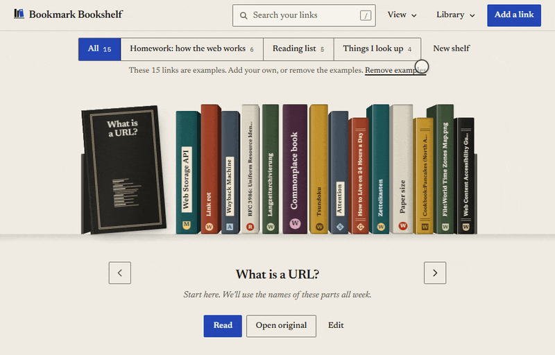
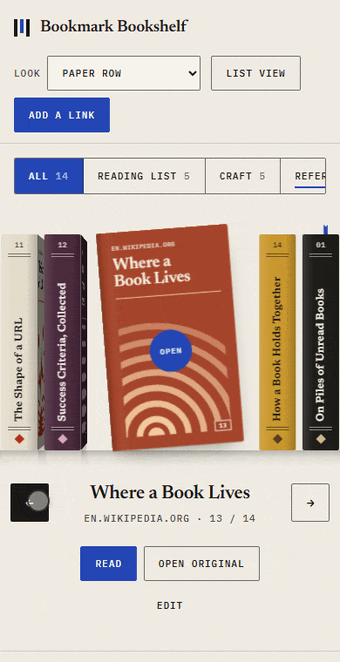
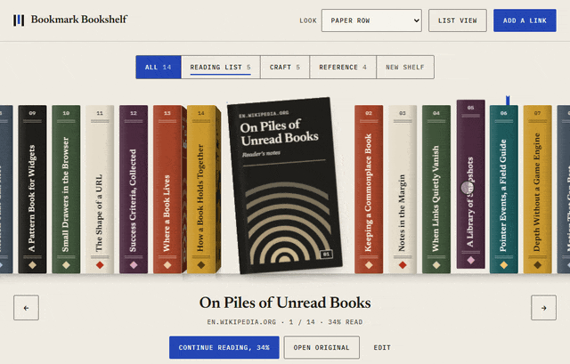

# Bookmark Bookshelf

**An open-source 3D bookmark manager: your saved links stand as volumes on an interactive bookshelf that you can drag, open and read.**

Saved links pile up in a flat list and lose their context. Here each link becomes a cloth-bound volume with a title on its spine. Drag the row, bring one to the centre, open it, and read the copy you saved with it. Close it and the shelf remembers the paragraph you stopped at.



*Recorded from the running app. The round pointer marker was added for the recording; everything else is the product.*

**Try it now**, no account and no server:

```bash
npm install
npm run dev
```

Then open `http://127.0.0.1:5173/` for the homepage or `http://127.0.0.1:5173/app.html` for your shelf. Node `^22.12.0`, `^24.0.0` or `>=26.0.0`.

## Pick your path

**I want to use it.** Run the two commands above and choose "Add a link". Paste the link, and if you want to read it in the app, paste the text too. Everything is stored in your browser's local storage. "Export library" in the footer gives you a JSON file you can keep or move to another browser.

**I want one part in my own project.** The shelf, the motion engine, the store and the reader are four folders that do not import each other. Copy the one you need from `src/` and mount it:

```ts
import { createShelfMotion, prefersReducedMotion } from './motion';
import { mountShelf } from './shelf';

const shelf = mountShelf(host, { items });
const motion = createShelfMotion({ count: items.length, loop: shelf.loop, reducedMotion: prefersReducedMotion });
motion.subscribe((state) => shelf.setPose({ position: state.position, open: 0 }));
motion.attach(shelf.surface, { pxPerItem: () => shelf.pitch() });
shelf.on((intent) => {
  if (intent.type === 'focus') motion.goTo(intent.slot);
  else if (intent.type === 'step') motion.step(intent.direction);
});
```

**I want a coding agent to build it in.** The repository carries a skill at [`.agents/skills/bookmark-bookshelf/`](.agents/skills/bookmark-bookshelf/SKILL.md). Copy that folder into your agent's skills directory, or point the agent at it in place, then ask:

> Use the bookmark-bookshelf skill. Build the whole shelf into this project: drag, local storage and the reader with resume, seeded from `links.json`.

> Use the bookmark-bookshelf skill. I only want the draggable 3D shelf for these eight titles. No storage, no reader.

## The four parts

| Module | Folder | What it does | Runs alone in |
|---|---|---|---|
| Shelf | [`src/shelf`](src/shelf) | Draws volumes in CSS 3D for a pose and reports what was picked. Four looks. | [`examples/shelf-only.html`](examples/shelf-only.html) (with motion) |
| Motion | [`src/motion`](src/motion) | Springs, drag, flick and snap on Pointer Events. Knows nothing about books. | same example |
| Store | [`src/store`](src/store) | Versioned library in local storage: validation, migration, import, export. | [`examples/store-only.html`](examples/store-only.html) |
| Reader | [`src/reader`](src/reader) | Shows a saved copy as text nodes only, tracks the position and hands it back. | [`examples/reader-only.html`](examples/reader-only.html) |

They meet in one file, [`src/app/bookshelf.ts`](src/app/bookshelf.ts). Contracts, wiring recipes and checks are in the skill's [`references/`](.agents/skills/bookmark-bookshelf/references).

Zero runtime dependencies. A production build of the app is about 59 kB of JavaScript before compression (23 kB gzipped), not counting the sample texts, measured from `npm run build`.

## Why keep it around

- **The drag is real.** Mouse, touch and trackpad move the row 1:1, a flick carries it, and it settles on a volume with a critically damped spring. On a phone a sideways swipe moves the shelf and a vertical one still scrolls the page.
- **It reads, and it remembers.** A volume opens into a page of the text you saved. Reload the tab and you are on the same volume at the same paragraph.
- **Your data stays with you.** Local storage only, a documented versioned JSON format, export and import. No account, no tracking, no network requests after the page has loaded.
- **Keyboard and screen readers are first-class.** One tab stop for the row, arrow keys, Home, End, Enter, Escape, focus returned to where you were, a plain list view, and a reduced-motion path that is instant instead of slower.
- **The parts are reusable.** Each module has its own tests and a small contract, and the skill lets an agent rebuild all or part of it elsewhere.




If the shelf is useful to you, a star helps other people find it.

## What the reader does and does not do

The reader shows text **you saved** with a link. It never fetches a page for you: most sites refuse that from a browser, and doing it safely needs a server this project does not have. A link saved without text says so, offers a field to paste the text, and always keeps a plain "Open original" link. Reading copies use a small markdown subset; anything else, including HTML, is shown as plain text and never run.

## Commands

| Command | What it does |
|---|---|
| `npm run dev` | Development server on `127.0.0.1:5173` |
| `npm run build` | Type check, then a static build in `dist/` |
| `npm run preview` | Serve `dist/` on `127.0.0.1:4173` |
| `npm test` | 411 unit tests (Vitest, happy-dom) |
| `npm run test:e2e` | 79 browser tests (Playwright: desktop Chromium, phone-sized Chromium with touch, WebKit smoke). Run `npx playwright install chromium webkit` once first |
| `npm run check` | Type check, unit tests and build |

The build is a folder of static files with relative URLs, so it can be served from any path. It is marked `noindex` until you build it with an approved address: `SITE_ORIGIN=https://your.domain npm run build` adds the canonical link and absolute sharing URLs.

## Limits

- No sync between devices beyond export and import.
- No automatic article extraction (see above).
- Tested in Chromium (desktop and phone-sized with touch) and smoke-tested in WebKit. Firefox has not been tested yet.
- Fonts are bundled for Latin and Latin Extended. Other scripts fall back to system fonts.

## How it came about

The row geometry, the turn-to-cover focus and the way a volume grows open into a page were independently reverse-engineered from a screen recording of a third-party shelf interface, by measuring frames. No code, artwork, text or brand element from it is used here. Drag, flick, touch, keyboard, reduced motion, the reader, the store, the cover art and the looks are original design. Details are in [PROVENANCE.md](PROVENANCE.md).

## Licence

Apache-2.0, see [LICENSE](LICENSE) and [NOTICE](NOTICE). Bundled typefaces (Newsreader, IBM Plex Mono) are under the SIL Open Font License 1.1; their licence texts ship in [`public/licenses/`](public/licenses) and are listed in [THIRD_PARTY_NOTICES.md](THIRD_PARTY_NOTICES.md). Changes are recorded in [CHANGELOG.md](CHANGELOG.md).
